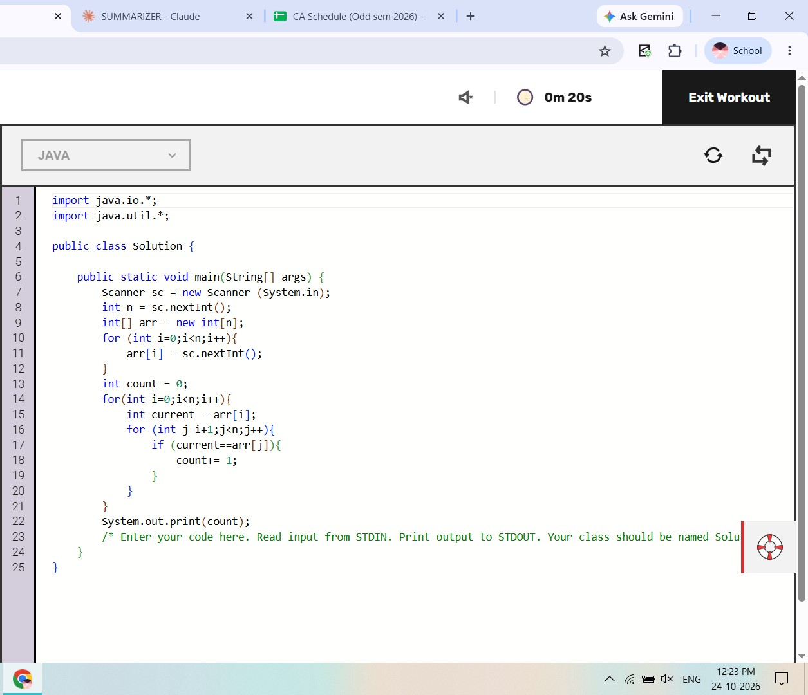
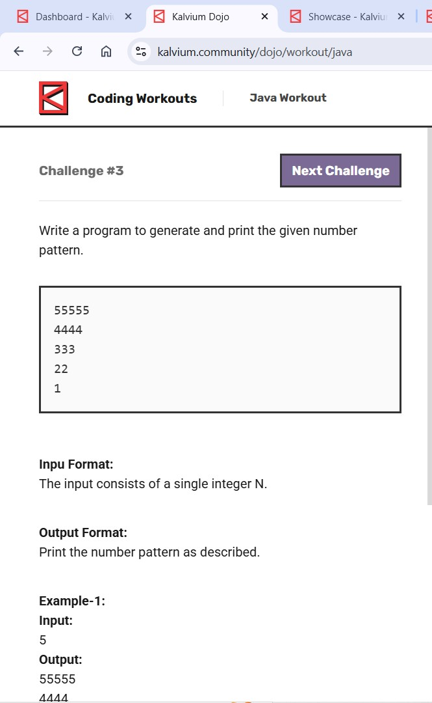
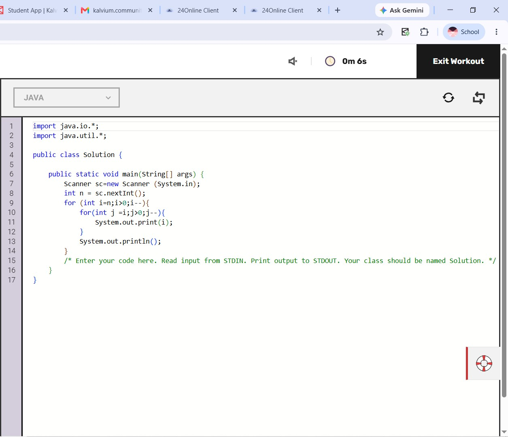
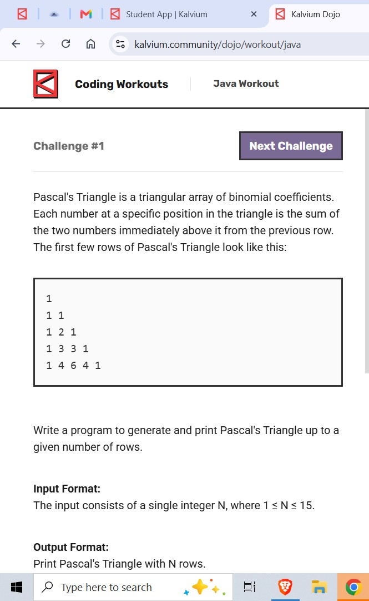
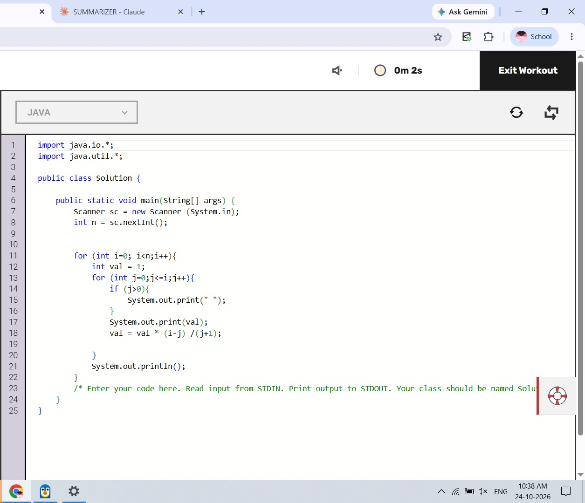

# JAVA questions

> 🤖 Auto-generated by the repo bot — please don't edit by hand. Open a question, try it yourself, then click **Show solution**.

**4 questions** in this language.

## Workout (3)

### Level not set yet (3)

<b>Good pairs j</b>

 

👀 Show solution

 

<b>Number pattern</b>

 

👀 Show solution

 

<b>Pascal s Triangle</b>

 

👀 Show solution

 

## Dojo (1)

<b>Frog step counter</b>

 

👀 Show solution

 

