# JAVA questions

> 🤖 Auto-generated by the repo bot. Please don't edit by hand. Open a question, try it yourself, then click **Show solution**.

**7 questions** in this language.

## Workout (4)

### Level 2 (4)

<b>Good pairs j</b>

 
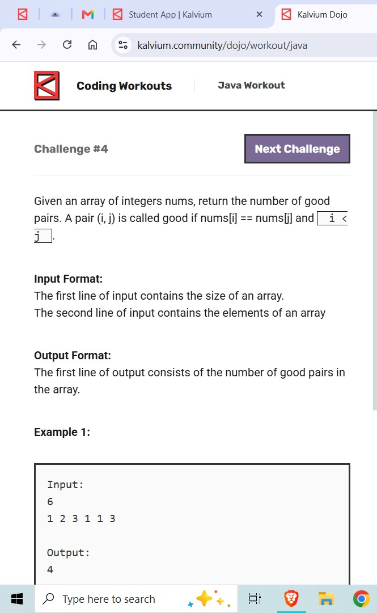

👀 Show solution

 
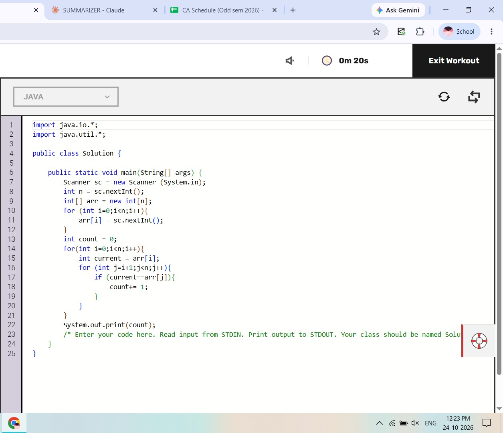

<b>L2 printing multiples</b>

 
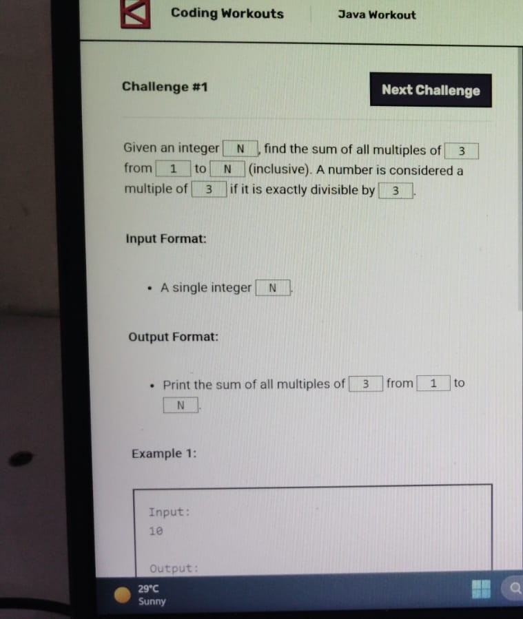

👀 Show solution

 
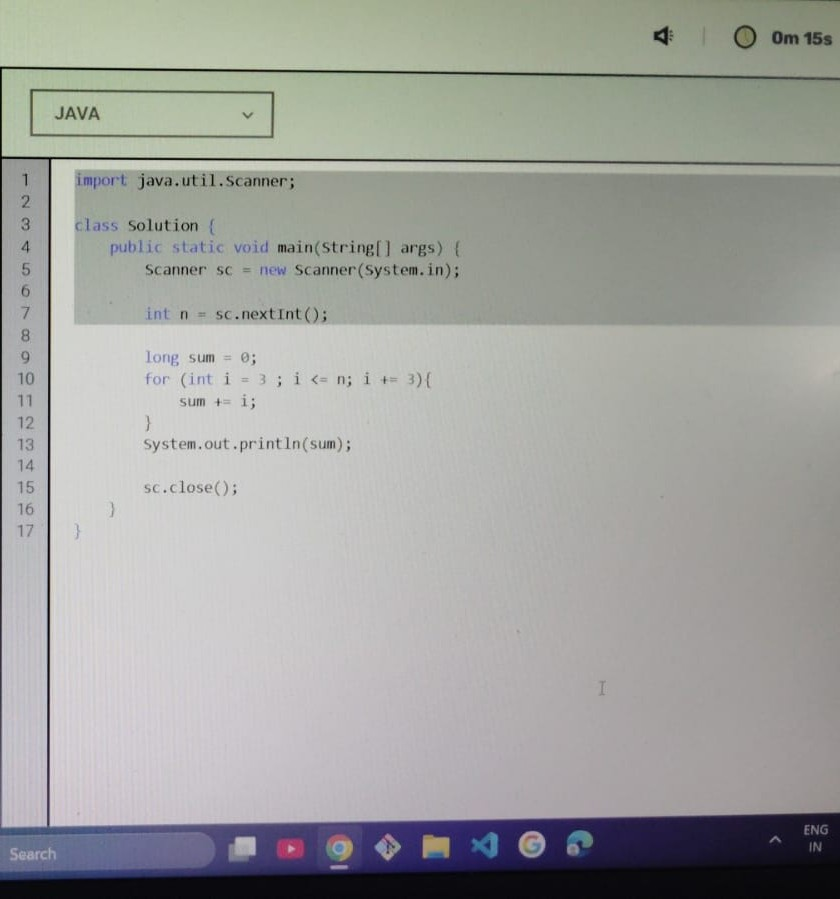

<b>Number pattern</b>

 
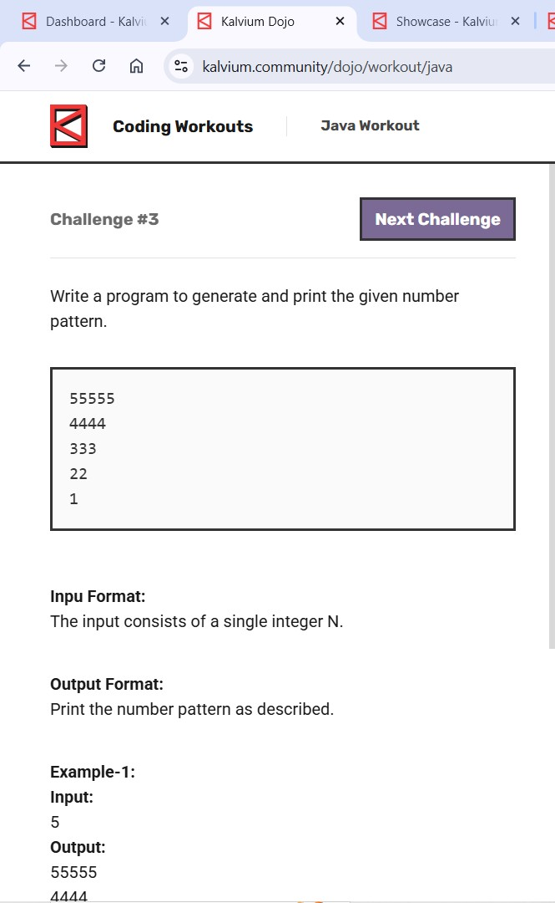

👀 Show solution

 
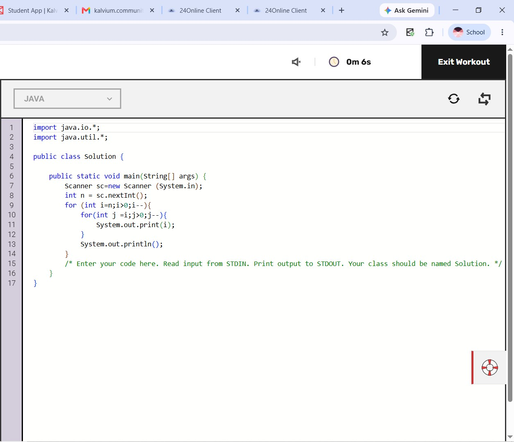

<b>Pascal s Triangle</b>

 
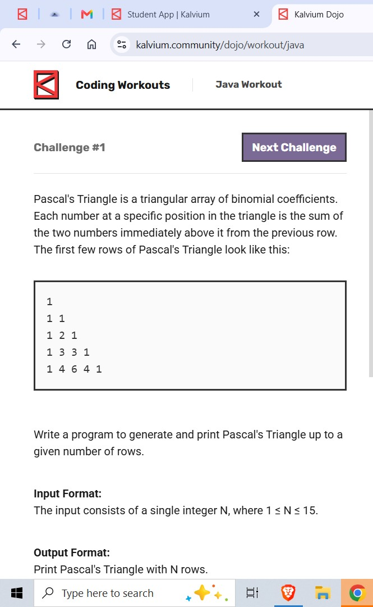

👀 Show solution

 
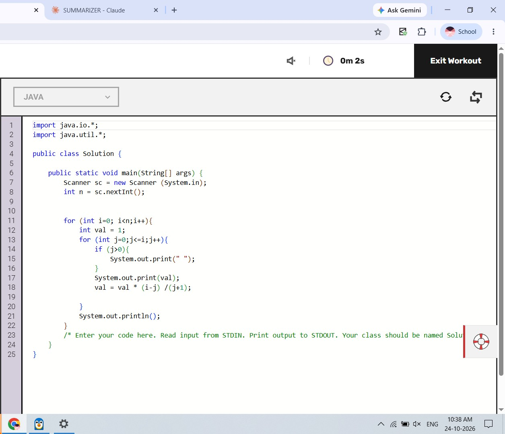

## Dojo (3)

### Level 2 (3)

<b>Frog step counter</b>

 
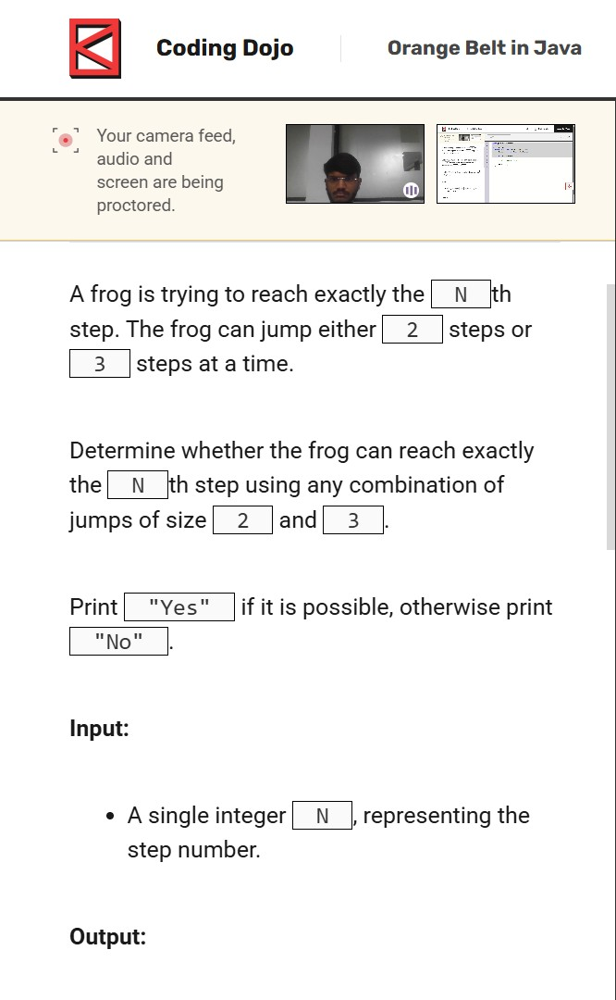

👀 Show solution

 
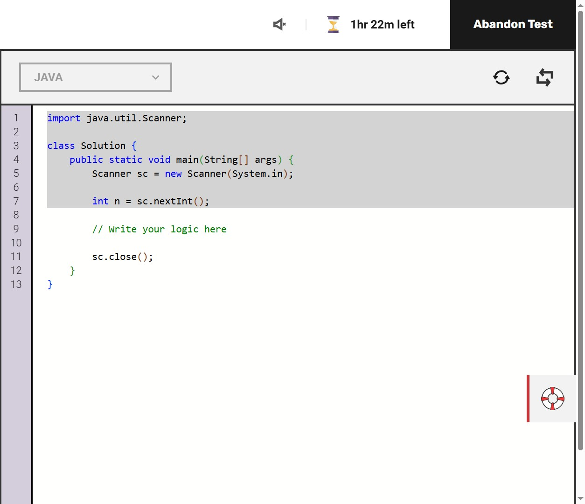

<b>loop n</b>

 
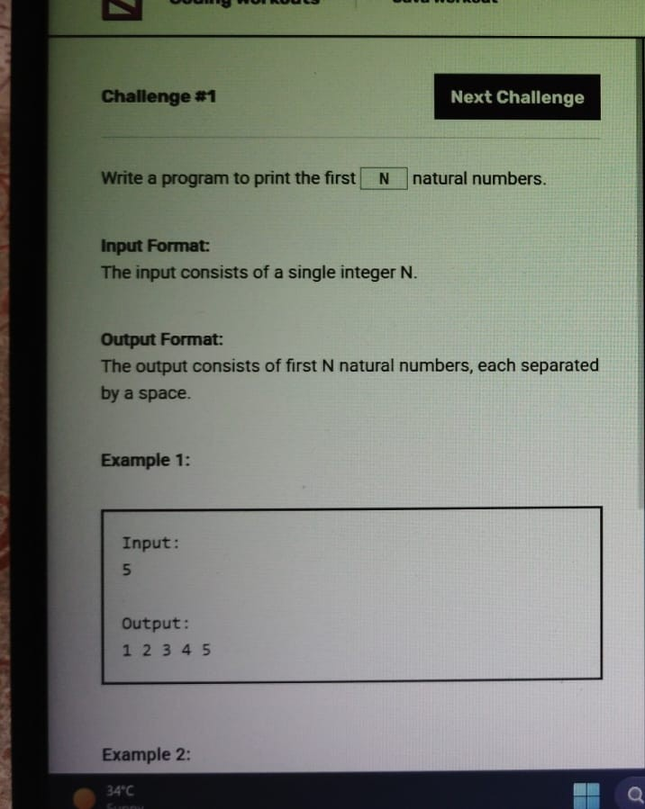

👀 Show solution

 
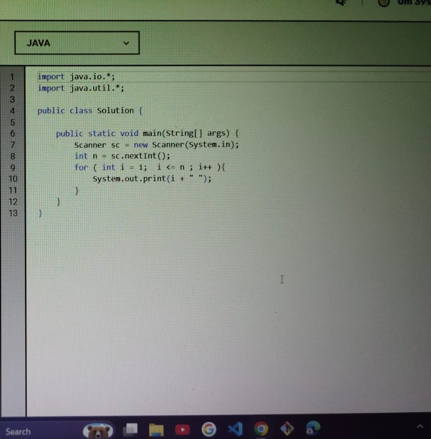

<b>sum of subarray</b>

 
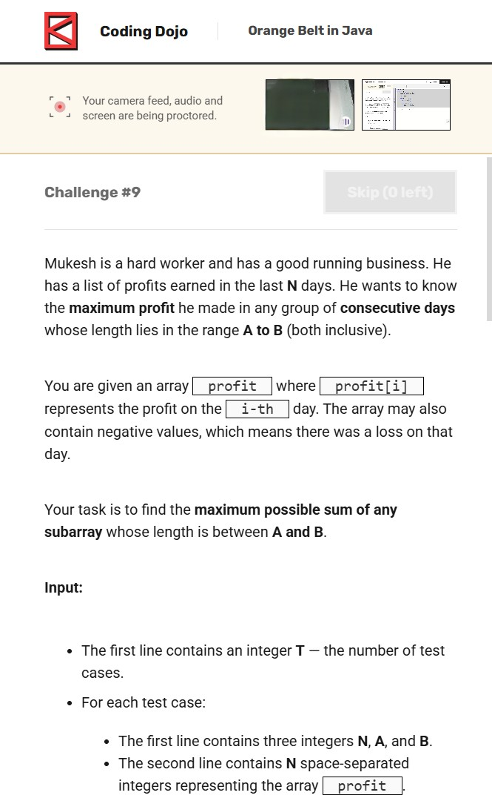

👀 Show solution

 
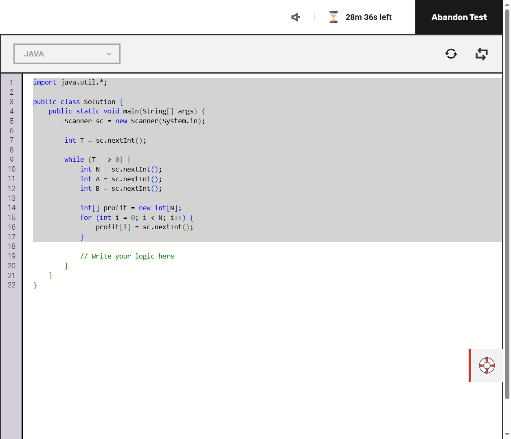

