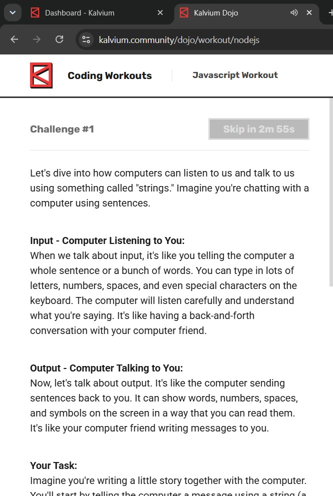
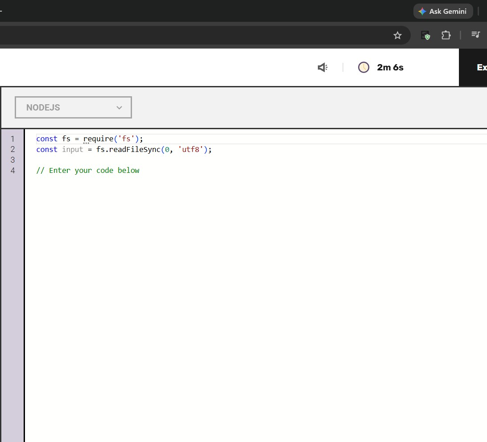

# JS questions

> 🤖 Auto-generated by the repo bot. Please don't edit by hand. Open a question, try it yourself, then click **Show solution**.

**1 questions** in this language.

## Workout (1)

### Level 1 (1)

<b>print output</b>

 

👀 Show solution

 

