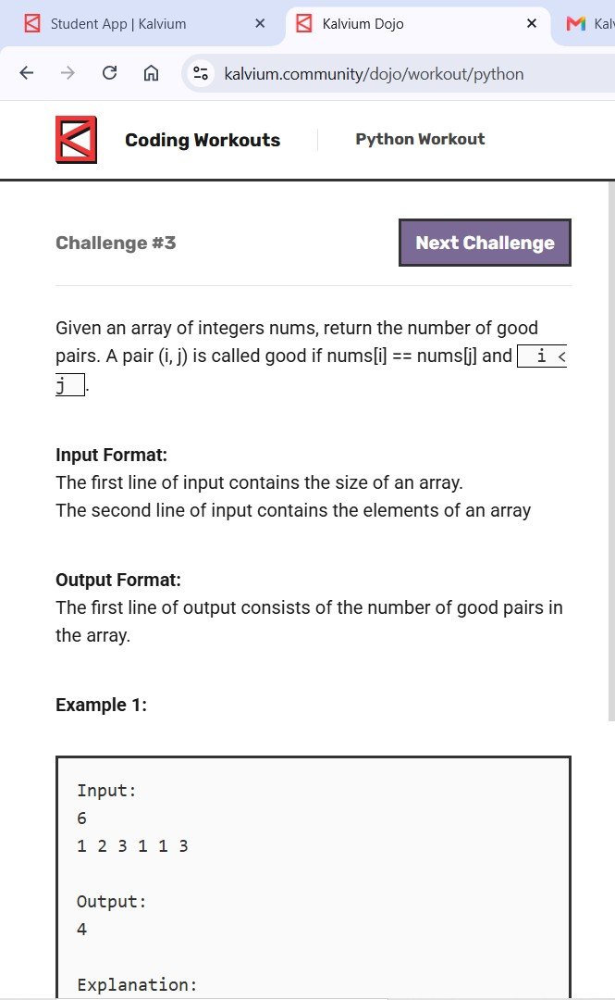
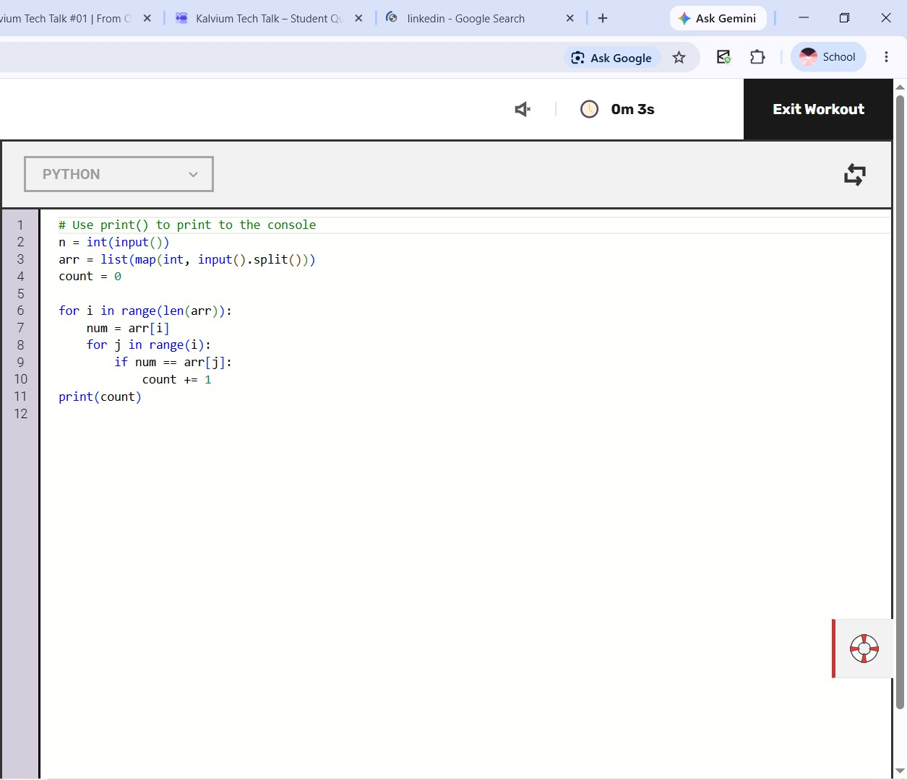
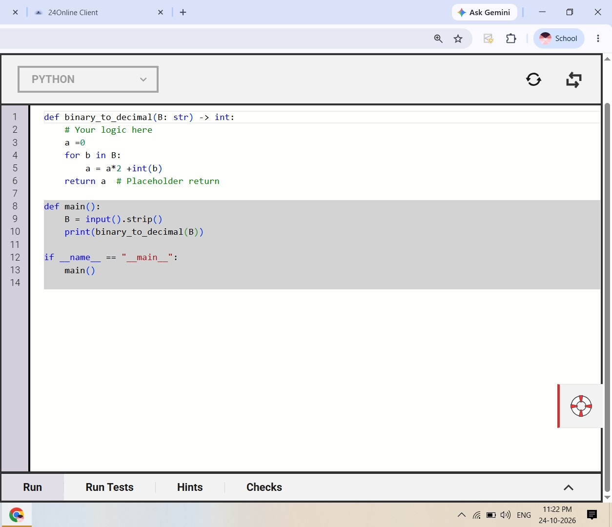
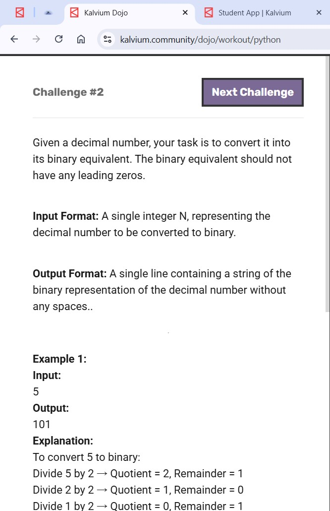
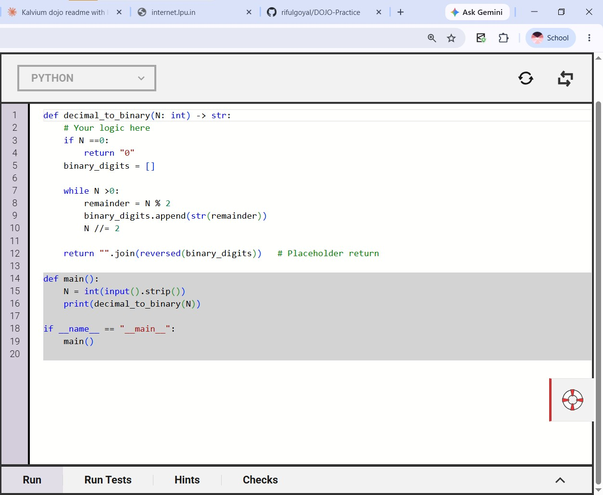

# PYTHON questions

> 🤖 Auto-generated by the repo bot. Please don't edit by hand. Open a question, try it yourself, then click **Show solution**.

**4 questions** in this language.

## Workout (4)

### Level 2 (2)

<b>Alternate numbers</b>

 

👀 Show solution

 

<b>Good pairs</b>

 

👀 Show solution

 

### Level 3 (2)

<b>Binary to decimal</b>

 

👀 Show solution

 

<b>Decimal to binary</b>

 

👀 Show solution

 

